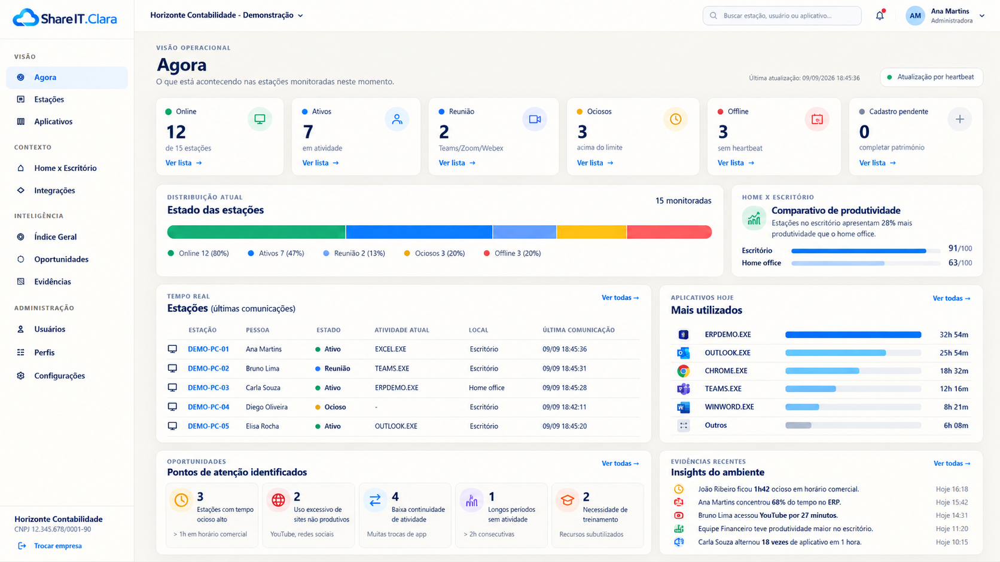
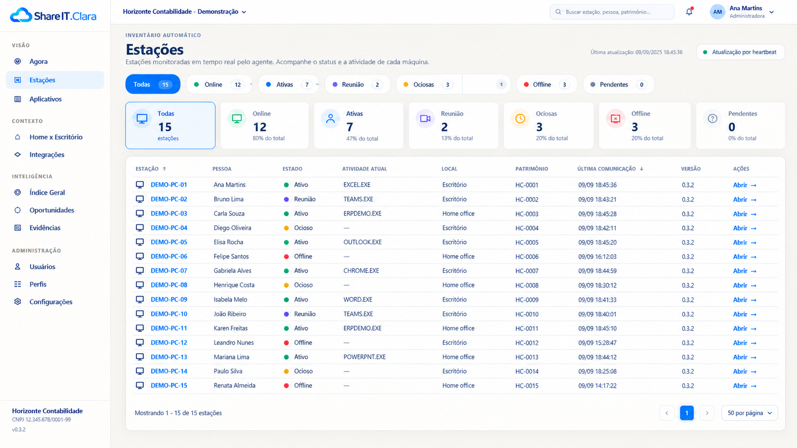
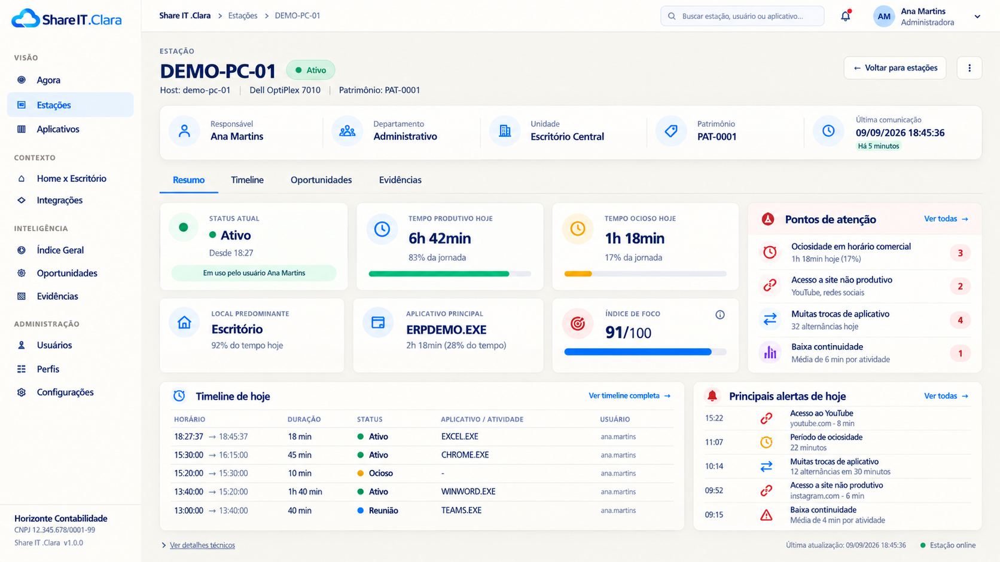
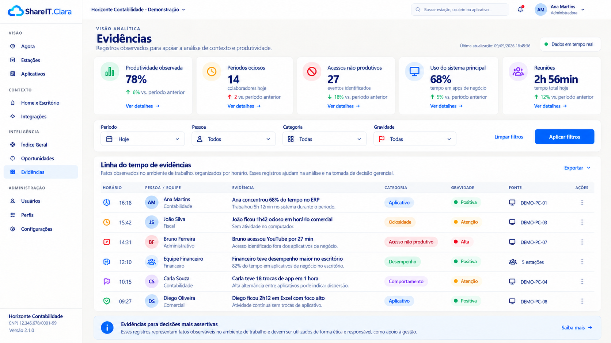
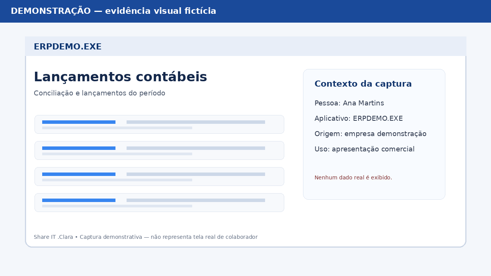
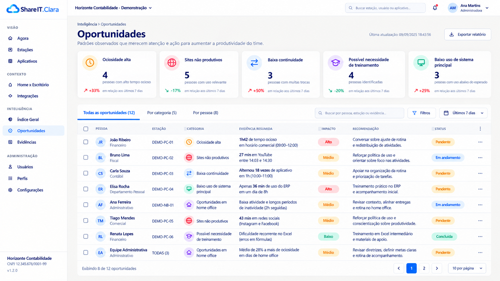
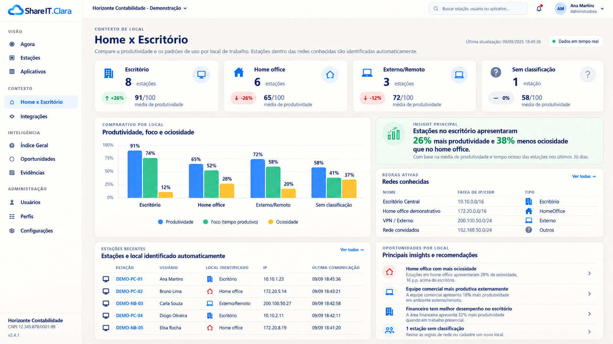
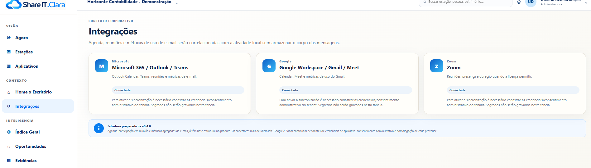
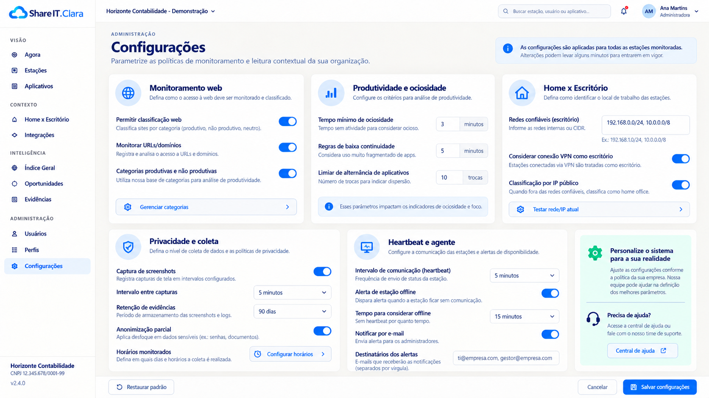

# Manual de usabilidade ilustrado — Share IT .Clara v0.5.6

## 1. O que é a Share IT .Clara

A **Share IT .Clara** é uma plataforma de monitoramento e leitura gerencial da rotina de trabalho. O objetivo não é apenas mostrar máquinas online, mas dar visibilidade sobre:

- quem está trabalhando;
- em que está trabalhando;
- o que trabalhou hoje;
- quais evidências sustentam essa leitura;
- quais oportunidades de melhoria podem ser acionadas.

---

## 2. Visão geral do fluxo de uso

1. O gestor abre a tela **Agora** para enxergar o panorama do momento;
2. Usa **Estações** para localizar pessoas e máquinas;
3. Abre o **detalhe da estação** para entender o dia do colaborador;
4. Consulta **Home x Escritório** para comparar contexto de trabalho;
5. Consulta **Oportunidades** para ações de gestão;
6. Consulta **Evidências** para comprovação e análise;
7. Usa **Integrações** para enriquecer a análise com agenda/reuniões/e-mail;
8. Usa **Configurações** e **Instalação** para administração da plataforma.

---

## 3. Tela Agora — visão operacional do momento

### Para que serve
A tela **Agora** é a primeira visão do dia a dia operacional. Ela responde rapidamente:

- quantas estações estão online;
- quantas estão ativas;
- quantas estão em reunião;
- quantas estão ociosas;
- quantas estão offline;
- quais são os principais pontos de atenção do momento.

### O que observar
- **Estado das estações**: distribuição rápida do ambiente;
- **Comparativo Home x Escritório**: leitura resumida do desempenho por local;
- **Estações (últimas comunicações)**: acompanhamento em tempo real;
- **Mais utilizados**: aplicativos mais usados no período;
- **Pontos de atenção identificados**: fatos com potencial gerencial;
- **Insights do ambiente**: resumos do dia.

### Uso recomendado
Use esta tela para abertura do acompanhamento diário e triagem inicial.

---

## 4. Tela Estações — quem está trabalhando agora

### Para que serve
A tela **Estações** é a principal lista operacional da plataforma.

### O que ela mostra
- total de estações;
- online;
- ativas;
- em reunião;
- ociosas;
- offline;
- pendentes;
- tabela com estação, pessoa, estado, atividade atual, local, patrimônio, última comunicação e versão.

### Como usar
- Filtre rapidamente pelo status desejado;
- Identifique quem está ativo, em reunião, ocioso ou offline;
- Entre no detalhe da estação pela ação **Abrir**.

---

## 5. Detalhe da estação — o que a pessoa fez hoje

### Para que serve
Esta tela é o coração da análise individual.

### Informações principais
- **Status atual**;
- **Tempo produtivo hoje**;
- **Tempo ocioso hoje**;
- **Local predominante**;
- **Aplicativo principal**;
- **Índice de foco**;
- **Pontos de atenção**;
- **Timeline do dia**;
- **Principais alertas de hoje**.

### O que o gestor responde aqui
- A pessoa está trabalhando?
- Em que está trabalhando?
- O que fez ao longo do dia?
- Houve ociosidade relevante?
- Houve acesso a site não produtivo?
- O padrão indica necessidade de orientação ou treinamento?

### Recomendação funcional
Quando o recurso de captura estiver habilitado, a estação também deve permitir consultar **prints/evidências visuais** do período.

---

## 6. Evidências — fatos observados

### Para que serve
A tela **Evidências** centraliza os fatos observados e sustentam a análise.

### Exemplos de evidências
- produtividade observada;
- períodos ociosos;
- acessos não produtivos;
- uso do sistema principal;
- reuniões;
- variações de comportamento;
- destaques positivos;
- alertas de foco e continuidade.

### Como usar
- Ajuste período, pessoa, categoria e gravidade;
- Analise a linha do tempo de evidências;
- Exporte dados quando necessário;
- Use esta tela como base para justificar ações gerenciais.

---

## 7. Evidências visuais — contexto por captura

### Para que serve
A v0.5.6 passa a exibir uma galeria de **evidências visuais** no módulo Evidências e no detalhe da estação. Na empresa Demonstração, as imagens são totalmente fictícias e identificadas como **DEMONSTRAÇÃO**.

### Como interpretar
- a captura visual complementa a timeline e o aplicativo observado;
- a imagem não substitui a evidência textual;
- em ambiente real, a coleta deve respeitar política do cliente, RBAC, auditoria, retenção e armazenamento;
- nesta versão a **captura real pelo agente continua desabilitada por padrão**.

---

## 8. Oportunidades — o que fazer com os fatos

### Para que serve
A tela **Oportunidades** transforma fatos observados em itens acionáveis.

### Exemplos de oportunidades
- ociosidade alta;
- sites não produtivos;
- baixa continuidade;
- possível necessidade de treinamento;
- baixo uso de sistema principal.

### Como interpretar
A oportunidade não é a prova; é a **ação sugerida** a partir de uma ou mais evidências.

Exemplo:
- Evidência: “27 min em YouTube”;
- Oportunidade: “Reforçar política de uso e orientar foco”.

---

## 9. Home x Escritório — comparação de contexto

### Para que serve
Comparar produtividade, foco e ociosidade por ambiente.

### O que observar
- quantidade de estações por local;
- produtividade média;
- foco (tempo produtivo);
- ociosidade;
- **Insight principal**;
- redes conhecidas;
- estações identificadas automaticamente;
- oportunidades/recomendações por local.

### Uso recomendado
Muito útil para o gestor identificar se o time rende melhor em determinado contexto e se existem padrões por área/local.

---

## 10. Integrações — contexto adicional

### Para que serve
Ativar ou preparar integrações com:
- Microsoft 365 / Outlook / Teams;
- Google Workspace / Gmail / Meet;
- Zoom.

### O que elas agregam
- contexto de reuniões;
- agenda;
- participação;
- sinais de uso de e-mail;
- correlação entre atividade local e compromissos.

### Observação importante
A .Clara funciona sem essas integrações. Elas servem para **enriquecer a análise**.

---

## 11. Configurações — parâmetros da organização

### Para que serve
Administrar critérios de monitoramento e políticas da plataforma.

### Principais grupos
- monitoramento web;
- produtividade e ociosidade;
- home x escritório;
- privacidade e coleta;
- heartbeat e agente.

### Recomendações
- Definir claramente o tempo mínimo de ociosidade;
- Revisar redes confiáveis;
- Definir retenção de evidências;
- Ajustar heartbeat e alertas conforme o perfil do cliente.

---

## 12. Instalação do agente

### Para que serve
A área de instalação centraliza:
- download do agente;
- QR Code;
- token temporário;
- instruções de implantação.

### Objetivo operacional
Permitir instalar e registrar rapidamente estações da empresa, sem espalhar artefatos em vários pontos.

---

## 13. O que o cliente mais quer ver

Na prática, os clientes normalmente priorizam quatro perguntas:

1. **Quem está trabalhando?**
2. **No que está trabalhando?**
3. **O que trabalhou hoje?**
4. **Quais evidências comprovam isso?**

Por isso, a rotina ideal de uso é:

- **Agora** → visão do momento;
- **Estações** → lista operacional;
- **Detalhe da estação** → aprofundamento do dia;
- **Evidências** → prova e contexto;
- **Oportunidades** → ação gerencial.

---

## 14. Tipos de evidência recomendados

### Evidências operacionais
- estação online/offline;
- heartbeat perdido;
- atividade atual;
- aplicativo principal;
- troca frequente de aplicativo;
- ociosidade em horário comercial;
- acesso a site não produtivo;
- reunião detectada;
- mudança de local;
- screenshot capturado.

### Evidências analíticas
- produtividade acima/abaixo da média;
- baixa continuidade;
- foco alto/baixo;
- padrão de uso fora da rotina;
- necessidade de treinamento;
- subutilização de sistema principal.

---

## 15. Boa prática de leitura gerencial

### Camada 1 — visão gerencial
- índices;
- insight principal;
- oportunidades;
- comparativos.

### Camada 2 — visão operacional
- quem está online;
- quem está ativo;
- em qual aplicativo;
- status do momento.

### Camada 3 — evidência
- timeline do dia;
- fatos observados;
- screenshots;
- exportação.

---

## 16. Conclusão

A .Clara deve ser apresentada como uma plataforma de **gestão com evidência**. O valor percebido cresce muito quando o ambiente de demonstração consegue mostrar, ao mesmo tempo:

- atividade realista;
- oportunidade gerencial;
- evidência associada;
- narrativa clara para o gestor.

Este manual acompanha a revisão funcional da versão v0.5.6.
